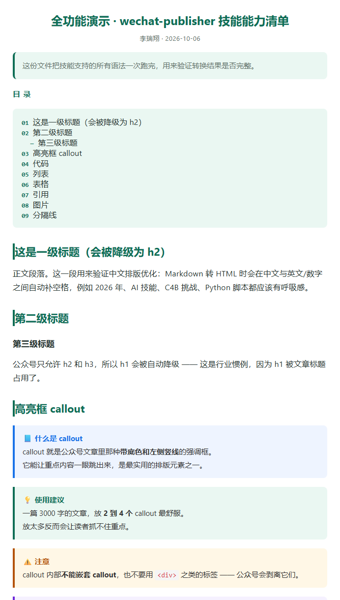

## 先说那个让我抓狂的场景

每次想在公众号发点东西，我都会经历同样的三十分钟。

写好的稿子从文档里复制过去，格式全乱了：小标题变得和正文一样大，加粗没了，列表缩进乱七八糟，代码块挤成一行丑得没法看。然后我就在公众号编辑器里一个字一个字地重新调——调字号、调行距、调颜色、调间距。

前二十分钟我在写作，后四十分钟我在做排版工。

最讽刺的是，每次调完的样式都差不多，但我从来没有把它"存下来"过。下一篇，从头再来一遍。

这篇文章讲的，就是我怎么把这三十分钟彻底消灭掉的过程。

---

## 我不是程序员，这一点很重要

先交代背景：我不写代码。看到 `for` 循环和缩进，我的第一反应是头晕。

所以当我拿到一个开源的小工具包，让我把它改造成"我自己的"版本时，我的第一反应是——这活儿应该是给会写代码的人准备的吧？

但后来我发现，**在 AI 时代，"改造一个工具"和"写一个工具"是两件完全不同的事**。

- 写工具，需要知道编程语言的语法、数据结构的选型、边界的处理。
- 改造工具，需要知道的是：它现在能做什么、不能做什么、我想要什么。

前者是技能，后者是判断力。而判断力，我可以有。

::: note 这篇文章说的"工具"到底是什么
它是一个跑在自己电脑上的小程序。你给它一篇 Markdown 或 Word 文档，它吐出一段排版好的 HTML，你把这段 HTML 粘贴进公众号编辑器，格式就自动是好的。
:::

---

## 第一步：先跑起来，再读懂它

我拿到的起点是一个别人写好的"起步工具包"。作者很坦诚，在里面留了一张清单，写着：

**它已经能做什么** —— 读 Markdown、读 Word、清理公众号不认的标签、套上基础样式。

**它还没做什么** —— 换配色、高亮框、自动目录、文章信息、页脚版权、中英文间距优化。

我先做的不是改，而是**跑**。

跑通之后，我做的第二件事是：把代码从头到尾读一遍，然后问自己一个问题——**它说自己能做的事，真的做到了吗？**

结果挺意外的。我找到了五个它没做到的地方。

### 我发现的五个真实缺陷

| 缺陷 | 表现 | 为什么值得修 |
|------|------|------------|
| 分隔线消失 | 文章里的 `---` 转换后不见了 | 长文靠它分节，没了整篇糊成一团 |
| 引用块被压扁 | 三行的引用变成一行，加粗也没了 | 引用是最常用的强调手段 |
| 图片没有宽度限制 | 长图在手机上直接撑破屏幕 | 手机端阅读体验直接崩 |
| 有一段代码是"死的" | 声明了 CSS 白名单，但从来没被用上 | 承诺过滤却没过滤，属于假功能 |
| 代码块换行丢失 | 十行代码挤成一行 | 技术类文章直接没法看 |

::: tip 这五条是怎么找出来的
我没有靠"感觉"。我把同一个测试文件分别喂给原版和我的版本，然后对比输出——数分隔线的数量、看引用块里有没有换行符、检查图片标签里有没有宽度设置。

**"对比两个版本的输出"**，比"盯着代码看"有效一百倍。
:::

这五条后来成了我笔记里最有价值的部分。因为它们证明了一件事：**我不只是把别人的东西搬过来，我真的读懂了它。**

---

## 第二步：把它变成"我的"

真正开始改造时，我用了一个叫"做技能的技能"的工具。听起来有点绕，其实它的作用很朴素：

它不会替我写代码，但它会**逼我把话说清楚**。

它要我回答一串问题：你这个工具到底干什么？什么情况下该被调用？输入是什么、输出是什么？边界情况怎么处理——文件是空的怎么办？格式不认识怎么办？然后它会让我把这些答案写成一份说明书，再照着说明书去实现，最后跑测试。

::: practice 你也想试的话，这一轮问题值得先想清楚
1. 这个工具解决我什么问题？用一句话说
2. 我给它什么？它给我什么？
3. 什么样的输入会让它出错？出错时我希望它怎么办？

想不清楚这三个问题，做出来的工具八成是半成品。
:::

我最后给它加了六样东西。（后来又补了几样，见第四步——那部分的起因比这六样有意思。）

### 我加的六项能力

| 能力 | 解决了什么 |
|------|-----------|
| 五套配色主题 | 同一篇文章可以换风格：技术教程用蓝色，随笔用青色 |
| 高亮框 | 就是你现在看到的这种带底色的框，公众号里最抓眼球的元素 |
| 自动目录 | 从标题自动生成编号目录，长文必备 |
| 文章信息 | 标题、作者、日期、摘要，写在文件开头就行 |
| 页脚版权 | 自动追加版权行，不用每次手写 |
| 中英文间距 | 中文和英文/数字之间自动空开一点，读起来不挤 |

表格里最后一条——**中英文间距**——值得单独说说。这个功能听起来很小，效果却意外明显——

原来：「我用AI写了个C4B技能，2026年发布」

优化后：「我用 AI 写了个 C4B 技能，2026 年发布」

差别就这么一点点空格，但专业的公众号和随手发的朋友圈，差别往往也就在这里。

---

## 第三步：让"能跑"变成"跑得放心"

改完之后，我做了一件在以前的我会看来很没必要的事：**写测试**。

十八个测试用例，每一条都对应一个功能。跑一遍，十几秒，全绿。

```
结果：20/20 通过
```

这东西的价值在我第三天改坏了一个功能时才体现出来。当时我调整了配色逻辑，顺手把代码块的字号改错了，自己完全没发现。跑一遍测试，当场报错，两分钟修好。

最后那几条用例，是我文章都快写完时才补上的。

第一条的起因：我无意中发现，工具吐出来的目录里赫然写着一行 `padding-left: 24px;` —— 一段本该藏在样式里的代码，被当成正文文字显示了出来。

第二条更隐蔽。我在一个高亮框里写了三条问题，生成出来的文章里，那三条问题**整段消失了** —— 高亮框的标题还在，底下的字全没了。而脚本照样报"通过"。

第三条是我定稿之后才撞上的。那次我做了件有点自虐的事：故意往工具里灌各种奇形怪状的输入 —— 空文件、只有标题没正文、忘了写收尾标记的高亮框、两百节的长文、混进 `<script>` 标签的文章。

大部分都扛住了。栽在一个我压根没想到的地方：**在高亮框的标题里写加粗**。正文里的加粗好好的，标题里的星号却原样印了出来，`**加粗**` 那两对星号就那么大喇喇地摆在读者眼前。

三个都是一类问题：**输出错了，但不报错。** 盯着代码看根本找不到，只有把输出当成一篇文章，从头读一遍才会发现。

而第三条还多说明了一件事：**正常写作永远不会在高亮框标题里写 markdown，所以正常流程走一百遍也碰不到它。** 只有主动去撞边界，它才会现形。

于是我把这三个场景都固化成了用例。

::: warn 一个我踩过的坑
我第一版测试里，"验证五套主题是否生效"这一条一直失败。查了半天，结果不是工具坏了，而是**我的测试写错了**——它把页面背景色当成了主题主色，五套主题的背景都是白色，所以永远"只出现一种颜色"。

工具没问题，尺子有问题。这件事让我明白：测试失败时，先怀疑测试。
:::

---

## 现在它长什么样

用了大概两周，我现在发一篇文章的流程是这样的：

1. 用 Markdown 写稿（AI 帮我打初稿，我来改；只有提纲也行——工具能把提纲扩成初稿）
2. 在文件开头填四行信息：标题、作者、日期、摘要（不填也能自动从正文补）
3. 运行一条命令
4. 浏览器打开，看一眼
5. 全选复制，粘进公众号编辑器
6. 手机上预览，发布

从"三十分钟调格式"变成了"三十秒复制粘贴"。

::: note 真正的变化不是省时间
省下的三十分钟当然很爽。但更重要的变化是：**我开始愿意多写东西了。**

以前"想到要排版"这件事，本身就是一道心理门槛，很多想法就死在这一步。现在这道门槛没了，写东西变成了一件顺手就能做的事。
:::

---

## 第四步：又补了几样，因为"能跑"不等于"证明过"

文章写到这儿本来可以收尾了。但我后来对着"评审标准"又看了一遍，发现自己有三件事只是在**自己说自己好**：

- 我说我加了图片处理，可我的文章里一张图都没有。
- 我说我的工具很稳，可我只用 Markdown 试过它，Word 那条路压根没走过。
- 我说它比原版好，可我从来没**量过**好多少。

三条是同一个毛病：**没有证据。**

### 第一样：图片

公众号的图片规则和网页完全不一样。外链的图会在保存时丢掉，SVG 存下来会消失，而本地路径它根本读不到——因为文件在你自己硬盘上。

所以图片必须在转换阶段就"焊"进 HTML 里。现在它会自动做三件事：把本地图片读成 base64 嵌进正文、给每张图加宽度上限（长图撑破手机屏幕是老毛病了）、把图片说明渲染成图注。



上面这张就是它吐出来的真实排版，不是我另画的示意图。

还有个细节值得说：**本地图、外链图、找不到的图、SVG** 这四种情况，在页面上看起来都是"一张没出来的图"。分不清它们，等于把"图片丢了"这件事藏起来。所以现在这四种会分别报出来，而不是悄悄放过。

### 第二样：一稿多投

同一篇稿子，公众号要 HTML，知乎要 Markdown，发群里要纯文本。以前这意味着改三遍。

现在一条命令出三份，**源稿只有一份**。顺手还做了四个骨架模板——技术教程、学习心得、技能介绍、复盘总结——开新稿时直接套，不用每次对着空白页想结构。

### 第三样：真的量一次

这一步最麻烦，也最值钱。

我做了一件以前觉得挺"学院派"的事：准备了 6 个测试用例，**每个用例都跑两遍——一遍用我的版本，一遍用最原始的版本**，逐条打分；每个用例还各跑 3 轮。


结果有点意外：在"基础转换"那一格，两个版本打平。**原版把最基础的事做得没问题**——它毕竟是别人认真写过的。差别全出在它没有的地方。

差距最大的是"结构元素"：100% 对 20%。原版会把多行引用压成一行、把代码块的换行全抹掉、把表格丢掉。这些不是我的功劳，是原版本来就缺的。

> 每个「用例 × 配置」的 3 次运行结果完全一致，方差为 0 ——
> 这是确定性脚本该有的样子，可复现性好；
> 同时也意味着它对输入措辞不敏感。

这段是我那份自动分析报告里**原样抄下来**的。它后半句其实是句批评：脚本的稳定是一种"假稳定"——换成真人来用，输入千变万化，它未必还这么稳。

::: warn 这一步让我改了一条判据
我原本写的一条判据是"输出里至少要有 5 个段落"。跑出来我的版本反而**输**了。

查完才发现：不是我的版本丢了东西，而是原版把 Word 里的列表项**全压成了普通段落**，段落数自然更多。**我的尺子量错了**——数段落个数，会把"丢结构"判成"更完整"。

后来我把这条换成"文档里的每一段文字都必须还在"。看见红灯先怀疑尺子，别急着怀疑代码——这一条我在这次改造里前后撞了三次。
:::

---

## 第五步：把要求当成清单，一条条打勾

到这儿我以为做完了。工具能跑、文章能发、效果也量过了。

直到有人问我一句：**"所有挑战要求你都达到了吗？"**

我这才回去，把挑战原文当成一张清单，一条一条打勾。打完发现——**有两项我没答上。**

**一项是完全没做。** 要求里写着"写作辅助集成：从大纲生成初稿"。我一直以为自己做了，因为我写了四套文章模板。一条条对原文才发现不是一回事：模板是**空骨架**，章节标题是固定死的，你往里面填；而要求的是**从一份提纲生成初稿**——章节来自你自己写的提纲。

这件事对我触动挺大：**我一直在回答"我这个工具还缺什么"，却从没问过"要求里的每一条我答得上吗"。** 前一个问题的主语是我自己，后一个问题的主语是要求。换个主语，缺口立刻显出来了。

**另一项是做了一半。** 要求写的是"**自动**加标题摘要"。我确实有摘要功能，但摘要得我手写在文件开头——那是手动，不是自动。

补这两项的过程中又踩了一个坑，挺有意思：

我给自动摘要写的规则是"取正文里第一个超过二十字的段落"。写完跑测试，挂了一条。

挂的原因很说明问题。那条测试里有一句话，是专门用来验证"自检脚本会不会把正常的代码引用误判成样式泄漏"的，那句话长这样：

> 正文里引用了 `padding-left: 24px;` 这样一个例子。

三十多个字，正好符合"第一个超过二十字的段落"——于是它被我的新功能**当成了文章摘要**。摘要一出现在开头，自检脚本立刻发现"正文里有样式声明"，判成泄漏。

**不是自检错了，是我的新功能把一篇好文章搞坏了。**

::: warn 这个坑真正的危险之处
它不报错。真实的文章里，如果第一段恰好是一句带代码的话，那读者在文章列表页上看到的摘要，就是一行样式代码。功能"正常工作"，结果很难看。
:::

修法是给摘要加两道筛子：跳过带代码的段落，跳过像样式声明的段落。改完再跑，二十个用例全过。

补完这两项，挑战里最难的那一级（Level 4）从"三项达标、一项做了一半、一项没做"，变成了**五项全达标**。

---

## 我从这件事里学到的三件事

**第一，非技术背景不是障碍，说不清楚才是。**

整个过程中我最费劲的不是任何一行代码，而是回答那个问题："我这个工具到底要解决什么？"——这个问题想不明白，工具就永远改不明白。

**第二，先跑起来，再读，最后才改。**

我一开始特别想直接动手改。如果真那么做，我根本不会发现那五个缺陷，因为我压根不知道原来的代码长什么样。**顺序错了，努力就白费。**

**第三，拿别人的东西不丢人，但拿完之后必须留下点什么。**

这个世界上已经有很多写好的工具了。你不需要从零开始，也不该从零开始。但"拿来"和"拿来主义"的区别在于：拿完之后，你是原样转发，还是搞清楚了它哪里好、哪里不够、然后把它变得更好一点。

后者才叫本事。

---

## 最后

如果你也在公众号上发东西，被排版折磨过，我想说的是：这件事比你想象的简单。

你不需要会写代码。你需要的是——

找到一个已经能跑的东西，跑通它，读懂它，然后诚实地问自己一句：

**"它哪里还不够好？"**

还有第二个问题，是我做到最后才学会问的——

**"要求里的每一条，我答得上吗？"**

第一个问题的答案，是你的起点。第二个问题的答案，决定你能不能走到终点。

---

*本文的内容本身就是用这个工具排版的。如果你也想要一个，说一声就行 —— 技能包和安装步骤我都整理好了，直接发你。*
