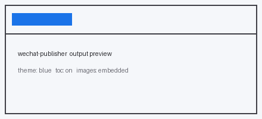

## 中英混排与图片

中文和英文挤在一起的时候，如果不加空格，读起来会非常挤。比如这句：我用Python写了一个脚本处理2026年的数据，一共跑了3小时。

加上空格之后就舒服多了：我用 Python 写了一个脚本处理 2026 年的数据，一共跑了 3 小时。

### 代码块不该被加空格

```python
total = 0
for i in range(3):
    total = total + i
print(total)
```

代码里的 `range(3)` 和 `total + i` 必须保持原样，多一个空格就可能语义全变。

### 图片



上面这张图来自本地文件。公众号的编辑器读不到你硬盘上的路径，所以图片必须在转换阶段就嵌进 HTML 里，否则粘过去之后只剩一个空框。
